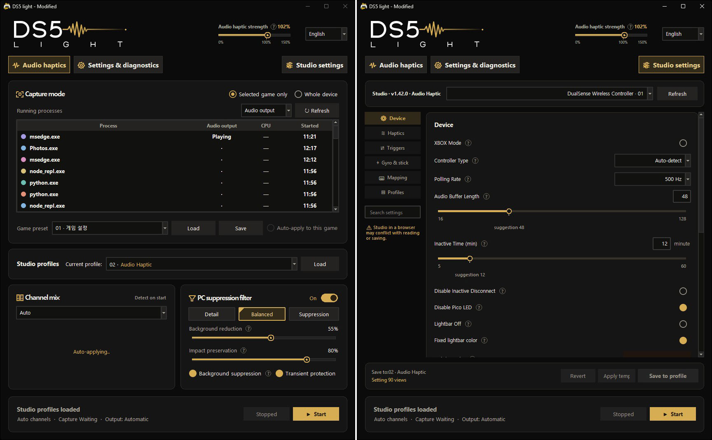

# DS5Dongle-Studio-DS5Light

A modified Studio firmware and DS5Light app that bring audio haptics processing and dongle configuration together in one Windows application.

Select audio from a game or application, adjust background suppression and impact preservation, and tune the audio haptics to your preference. Studio configuration features previously accessed through the web interface are integrated into the app, so you can manage audio processing, profiles, triggers, and macros in one place.

This project is based on:

- Studio firmware: [artzox/DS5Dongle-Studio](https://github.com/artzox/DS5Dongle-Studio)
- DS5Light app: [fnflwkd/DS5Light](https://github.com/fnflwkd/DS5Light)

Thank you to the original authors and contributors. This repository contains modified versions of both projects.

## Download and quick start

**Release v1.0.6 · DS5Light v1.0.6 · Studio firmware v34**

Download the two attachments from [Releases](https://github.com/grayexoc/DS5Dongle-Studio-DS5Light/releases/latest):

| File | Purpose |
| --- | --- |
| `ds5-studio-light_v34.uf2` | Studio firmware for **Raspberry Pi Pico 2 W**. This attachment is not for RP2040 Pico W or Waveshare boards. |
| `DS5Light-win-x64-v1.0.6-Experimental.zip` | Complete Windows x64 app package. Python is not required. |

1. Back up current dongle settings and slots. To install this firmware, enter BOOTSEL mode on the Pico 2 W and copy the UF2 to its USB drive. The app does not flash firmware automatically.
2. Extract the entire app ZIP into a writable folder. Run `DS5Light.exe`, keeping `_internal` beside it. GitHub's automatic **Source code** archives are not the executable package.
3. Connect the dongle and controller. In **Studio settings → Recommended presets**, choose a preset and save slot, then **Save and use**. The included files are `Studio Presert/DS_Native.json`, `Audio_Haptic_01.json` and `Audio_Haptic_02.json`.
4. In **Audio haptics**, select the capture target and output, check the filter and gain, then start processing. New preferences default to PC suppression on, Balanced, 55% suppression, 85% impact preservation and 100% gain; existing preferences take precedence.
5. For native-haptics games, stop app audio processing and select a suitable native profile. Turning off only the PC filter leaves audio transmission active.

Recommended presets change only the current audio-haptics fields, preserving other **current** settings, then save that resulting configuration to the chosen slot. Overwriting a slot replaces its previous contents. Loading an existing dongle slot applies its full configuration.

DS5Light requires Windows 10/11 x64; selected-application capture requires build 20348 or later. Earlier Windows 10 builds can use whole-device capture. Additional settings and tests require firmware support; OLED features need the appropriate display and wiring.

[Detailed setup](DS5Light/SETUP.md) · [App guide](DS5Light/README.txt) · [Versions and release notes](DS5Light/RELEASE_NOTES.md)

## DS5Light features in this version

### App preview

Left: **Audio haptics** — select the capture target, manage game presets and adjust channel mixing, suppression and haptic strength. Right: **Studio settings** — configure the dongle inside the app. This image shows these two screens; it does not show the diagnostics screen. Values and version labels in the image are examples, not installation defaults.

### Audio haptics processing

- Audio source selection: Send audio from a specific game or application, or capture the entire selected output device. The original audio you hear through your speakers or headphones remains unchanged.
- Background suppression and impact preservation: Reduce unwanted vibration from sustained background sounds while retaining the response of brief effects. Adjust suppression and impact preservation independently.
- Haptic strength control: Adjust output gain separately from the filter settings to suit each game and your preference.
- Multichannel audio: Support automatic, stereo, 5.1, and 7.1 capture, with controls for the contribution of center, LFE, rear, and side channels in multichannel input.
- Per-game presets: Store settings in 12 presets and associate them with games. The app also remembers the last-used options and window size.

The filter uses changes over time and energy levels across frequency bands. It does not fully separate music, dialogue, and sound effects. Results depend on the game's audio mix and your settings.

### Integrated Studio configuration

- Momentary Shift mappings: Choose a Shift button and edit Base/Shift layers; unspecified Shift inputs inherit Base. The Shift key is suppressed from game input and uses one of 32 global macro records, with per-profile enable states.
- Profile-switch mapping: Assign profile 1–8, with an optional chime and preview. Empty/current profiles are not switched; release the source input before another activation. Chime volume follows the profile's speaker/headset settings.

- Dongle settings: Read and edit Studio settings for audio haptics, triggers, gyro, buttons, macros, and LEDs directly in the app.
- Profiles and slots: Load profiles stored on the dongle, manage settings and slots, and back up or restore configurations.
- Trigger and macro editing: Edit trigger effects and button actions, then apply the settings to the dongle.
- Power and connection settings: On supported firmware, manage sleep, dock behavior, USB gamepad mode, and other additional settings.

### Convenience and diagnostics

- High-DPI layout: Per-monitor awareness, logical pixel scaling, DPI-aware shared controls and work-area bounds. Popups share the main window scale, including when the main window moves between monitors.
- Task lifecycle: Device-lock waits are bounded, pending resume callbacks respect later stop/route changes, and thread startup avoids a Tk finalizer/startup-handshake deadlock.

- Controller status: View connection and battery information.
- Device diagnostics and output tests: Read dongle status and output statistics, and run individual tests for conventional rumble, adaptive triggers, and native haptics.
- Microphone button shortcut: Assign a keyboard shortcut to the DualSense Mute button.
- Korean and English UI: Switch languages and use setting descriptions to help adjust features in the app.

Save mapping changes in this order: **stage edits → save Pico mappings/macros → save the current profile**. Back up before changing slots. Clear/disable extended records before downgrading to unsupported firmware; Edge onboard Fn+face combinations may conflict with onboard profile switching. [Mapping guide](DS5Light/MAPPING_GUIDE_KO.md) · [DPI details](DS5Light/DPI_LAYOUT_KO.md).

Availability of additional settings and diagnostics depends on the connected firmware and device environment.

## Main differences from upstream Studio

The Studio firmware has been modified to support DS5Light integration and additional features. Changes also cover audio and rumble processing, LED control, power management, and configuration storage.

- Extended app protocol: Added communication features for checking configuration save results, reading device status, and running output tests.
- XInput mode: Added a selectable XInput mode alongside DualSense mode. This requires a firmware build with XInput support enabled.
- Audio and rumble adjustments: Modified transitions between native haptics and conventional rumble, output queues and retries, rumble strength and release behavior, and peak limiting in Mix mode.
- Extended LED control: Added fixed lightbar color and extended player LED controls, with improvements to restoring game-controlled LED states when switching settings.
- OLED status display: Added dongle status display support for compatible hardware.
- Extended power management: Added app-initiated sleep, automatic sleep, and a setting to disconnect the controller when docked.
- Storage, restoration, and output cleanup: Updated flash storage, profile restoration, and output handling during disconnects, reconnects, and USB suspend.

This is a summary of the main changes. See docs/ for implementation details, change history, and validation scope.

## Repository layout

- Repository root: Modified Studio firmware source
- DS5Light/: Modified DS5Light app source, user documentation, and assets
- docs/: Firmware changes, communication protocols, and validation notes

## Original Studio documentation

[README.upstream.md](README.upstream.md) preserves the upstream README for reference, with its source revision identified. Its version numbers, web-portal steps, downloads and board-specific files describe upstream, not the attachments in this fork's release. Use the current setup links above to install and configure this version.

## Credits and licenses

The Studio firmware retains its MIT license. DS5Light's own code is covered by DS5Light/LICENSE.txt. Third-party components retain their respective licenses and attribution notices.

Original projects:

- https://github.com/artzox/DS5Dongle-Studio
- https://github.com/fnflwkd/DS5Light

---

# 한국어

# DS5Dongle-Studio-DS5Light

DS5Dongle-Studio 펌웨어와 DS5Light를 기반으로, 오디오 햅틱 처리와 동글 설정을 하나의 Windows 앱에서 사용할 수 있도록 수정·확장한 프로젝트입니다.

오디오 햅틱의 체감 향상을 위해 게임이나 프로그램의 오디오를 선택하고, 배경음 억제와 타격감 보존 정도를 조절할 수 있습니다. 기존 Studio 웹 설정에서 다루던 기능도 앱에 통합하여, 오디오 처리부터 프로필·트리거·매크로 설정까지 한곳에서 관리할 수 있도록 구성했습니다.

이 프로젝트는 다음 두 원본을 바탕으로 합니다.

- Studio 펌웨어: [artzox/DS5Dongle-Studio](https://github.com/artzox/DS5Dongle-Studio)
- DS5Light 앱: [fnflwkd/DS5Light](https://github.com/fnflwkd/DS5Light)

원본 제작자와 기여자분들께 감사드립니다. 이 저장소에는 두 프로젝트를 바탕으로 수정한 펌웨어와 앱이 함께 포함되어 있습니다.

## 다운로드와 시작

**릴리즈 v1.0.6 · DS5Light v1.0.6 · Studio 펌웨어 v34**

[Releases](https://github.com/grayexoc/DS5Dongle-Studio-DS5Light/releases/latest)에서 첨부 파일을 받으세요.

| 파일 | 용도 |
| --- | --- |
| `ds5-studio-light_v34.uf2` | **Raspberry Pi Pico 2 W**용 Studio 펌웨어입니다. RP2040 Pico W나 Waveshare용 파일이 아닙니다. |
| `DS5Light-win-x64-v1.0.6-Experimental.zip` | 실행에 필요한 파일을 포함한 Windows x64 앱입니다. Python 설치는 필요하지 않습니다. |

1. 현재 동글 설정과 슬롯을 백업합니다. 펌웨어 설치 시 Pico 2 W를 BOOTSEL 모드로 연결하고 USB 드라이브에 UF2를 복사하세요. 앱이 펌웨어를 자동으로 설치하지는 않습니다.
2. 앱 ZIP 전체를 쓰기 가능한 폴더에 풀고 `DS5Light.exe`를 실행합니다. `_internal` 폴더를 함께 유지하세요. GitHub의 자동 **Source code** 압축 파일은 실행 배포본이 아닙니다.
3. 동글과 컨트롤러를 연결하고 **Studio설정 → 추천 프리셋**에서 프리셋과 저장 슬롯을 선택한 뒤 **저장 후 사용**을 누릅니다. 파일은 `Studio Presert/DS_Native.json`, `Audio_Haptic_01.json`, `Audio_Haptic_02.json`입니다.
4. **오디오햅틱**에서 캡처 대상과 출력을 선택하고 필터·세기를 확인한 뒤 시작합니다. 새 설정의 기본값은 PC 필터 켬·균형·억제량 55%·타격 보존 85%·세기 100%이며 기존 저장 설정이 우선합니다.
5. 네이티브 햅틱 게임은 앱의 오디오 처리를 정지하고 적절한 네이티브 프로필을 사용하세요. PC 필터만 끄면 오디오 전송은 계속됩니다.

추천 프리셋은 현재 구성의 오디오햅틱 항목만 변경하고 **현재**의 다른 설정을 유지한 결과를 선택한 슬롯에 저장합니다. 슬롯을 덮어쓰면 그 슬롯의 기존 내용이 교체됩니다. 기존 동글 슬롯을 불러오는 경우에는 슬롯의 전체 설정이 적용됩니다.

DS5Light는 Windows 10/11 x64용이며 게임 전용 캡처에는 빌드 20348 이상이 필요합니다. 이전 Windows 10에서는 장치 전체 캡처를 사용하세요. 추가 설정·테스트에는 펌웨어 지원이 필요하며 OLED는 해당 디스플레이와 배선이 필요합니다.

[상세 설치 안내](DS5Light/SETUP_KO.md) · [앱 사용법](DS5Light/README_KO.txt) · [버전 및 릴리즈 안내](DS5Light/RELEASE_NOTES.md)

## 이 버전의 DS5Light 주요 기능

### 오디오 햅틱 처리

- 캡처 대상 선택: 특정 게임·프로그램의 오디오 또는 선택한 출력 장치 전체의 오디오를 동글로 전달합니다. 스피커나 헤드폰으로 듣는 원래 소리는 바꾸지 않습니다.
- 배경음 억제와 타격 보존: 지속되는 배경음으로 인한 불필요한 진동을 줄이고 짧은 효과음의 반응을 살리는 필터를 제공합니다. 배경 억제량과 타격 보존량을 각각 조절할 수 있습니다.
- 진동 세기 조절: 필터 설정과 별도로 햅틱 출력 게인을 조절하여 게임과 취향에 맞게 강도를 맞출 수 있습니다.
- 다채널 오디오 처리: 자동·스테레오·5.1·7.1 캡처를 지원하며, 다채널 입력에서 센터·LFE·후방 및 측면 채널의 기여를 조절할 수 있습니다.
- 게임별 프리셋: 12개 프리셋에 설정을 저장하고 게임별 연결에 활용할 수 있습니다. 마지막 사용 옵션과 창 크기도 저장합니다.

필터는 소리의 시간적 변화와 대역별 에너지를 이용하는 방식입니다. 음악·대사·효과음을 완전히 분리하는 기능은 아니며, 체감 결과는 게임의 사운드 구성과 설정에 따라 달라집니다.

### Studio 설정 통합

- 시프트 매핑: 시프트 버튼을 누르는 동안 기본/시프트 레이어를 전환하고 미지정 입력은 기본 매핑을 상속합니다. 시프트키는 게임으로 보내지 않으며 공통 매크로 32칸 중 한 칸을 사용합니다. 사용 체크는 프로필별입니다.
- 프로필 전환 매핑: 프로필 1~8을 동작에 지정하고 선택적으로 전환 신호음·미리듣기를 사용합니다. 빈 슬롯·현재 슬롯은 전환하지 않으며 재전환 전 입력을 놓아야 합니다. 신호음은 프로필의 스피커 음량·헤드셋 경로를 따릅니다.

- 동글 설정 편집: 오디오 햅틱, 트리거, 자이로, 버튼·매크로, LED 등 Studio 설정을 앱에서 조회하고 수정합니다.
- 프로필·슬롯 관리: 동글에 저장된 프로필을 불러오고, 설정과 슬롯을 관리하며 백업·복원 기능을 사용합니다.
- 트리거·매크로 편집: 트리거 효과와 버튼 동작을 편집하고 관련 설정을 동글에 적용합니다.
- 전원·연결 설정: 지원 펌웨어에서 휴면, 도크 연결 시 동작 및 USB 게임패드 모드 등의 추가 설정을 관리합니다.

### 사용 편의 및 진단

- 고배율 UI: 모니터별 DPI 인식, 논리 픽셀 변환, 공통 컨트롤 배율과 작업 영역 안의 창 배치를 지원합니다. 팝업은 메인 창 배율을 공유하며 메인 창 이동 시 함께 갱신됩니다.
- 작업 수명 관리: 장치 잠금 대기를 제한하고, 지연 재시작은 이후의 정지·경로 변경을 존중합니다. 스레드 시작 시 Tk 객체 정리와 시작 신호가 서로 기다리는 교착을 방지합니다.

- 컨트롤러 상태 표시: 연결 상태와 배터리 정보를 확인할 수 있습니다.
- 장치 진단과 출력 테스트: 동글 상태와 출력 통계를 조회하고 일반 진동·트리거·네이티브 햅틱을 개별 시험할 수 있습니다.
- 마이크 버튼 단축키: DualSense의 Mute 버튼에 키보드 단축키를 지정할 수 있습니다.
- 한국어·영어 UI: 언어 전환과 설정 항목 설명을 제공하여 앱에서 기능을 확인하며 조절할 수 있습니다.

매핑 저장 순서는 **편집에 반영 → Pico 매핑·매크로 저장 → 현재 프로필에 저장**입니다. 슬롯 변경 전에 백업하고, 구형 펌웨어로 내리기 전 확장 레코드를 제거하거나 해제하세요. Edge 자체 Fn+도형 버튼은 내장 프로필 전환과 겹칠 수 있습니다. [매핑 안내](DS5Light/MAPPING_GUIDE_KO.md) · [DPI 안내](DS5Light/DPI_LAYOUT_KO.md).

추가 설정과 진단 기능의 사용 가능 여부는 연결된 펌웨어와 장치 환경에 따라 달라집니다.

## 원본 Studio와의 주요 차이점

Studio 펌웨어는 DS5Light와의 연동 및 기능 확장을 위해 일부 개조했습니다. 앱 연동뿐 아니라 오디오·진동 처리, LED 제어, 전원 관리와 설정 저장에도 변경 사항이 포함되어 있습니다.

- 앱 연동 확장: 설정 저장 결과 확인, 장치 상태 조회 및 출력 테스트를 위한 통신 기능을 추가했습니다.
- XInput 모드: 기존 DualSense 모드 외에 XInput 모드를 선택하는 기능을 추가했습니다. 해당 기능을 포함한 펌웨어 빌드가 필요합니다.
- 오디오·진동 처리 조정: 네이티브 햅틱과 일반 진동 간 전환, 출력 큐와 재시도, 진동 강도·해제 동작 및 Mix 모드의 피크 제한 방식을 수정했습니다.
- LED 제어 확장: 고정 라이트바 색상과 플레이어 LED 제어를 확장하고, 설정 전환 시 게임에서 지정한 LED 상태를 복원하는 처리를 보완했습니다.
- OLED 상태 표시: 지원 하드웨어에서 동글의 상태를 표시하는 기능을 추가했습니다.
- 전원 관리 확장: 앱에서의 수동 휴면, 자동 휴면 및 도크 연결 시 컨트롤러 연결 해제 설정을 추가했습니다.
- 저장·복원 및 출력 정리 보완: 플래시 저장과 프로필 복원, 연결 해제·재연결 및 USB 절전 상황의 출력 처리 등을 수정했습니다.

위 내용은 주요 변경 사항의 요약입니다. 세부 구현과 변경 이력, 검증 범위는 docs/의 문서를 참고하세요.

## 저장소 구성

- 저장소 루트: 수정된 Studio 펌웨어 소스
- DS5Light/: 수정된 DS5Light 앱 소스, 사용 안내 및 관련 자산
- docs/: 펌웨어 변경 사항과 통신 규약, 검증 관련 문서

## 원본 Studio 문서

[README.upstream.md](README.upstream.md)에 원본 README와 기준 커밋을 명시해 참고용으로 보관합니다. 그 문서의 버전·웹 포털 절차·다운로드·보드별 파일은 원본 기준이며 이 포크의 릴리즈 첨부 목록이 아닙니다. 현재 버전의 설치·설정에는 위의 최신 안내를 사용하세요.

## 출처 및 라이선스

Studio 펌웨어는 기존 MIT 라이선스를, DS5Light 자체 코드는 DS5Light/LICENSE.txt를 따릅니다. 외부 구성요소는 각각의 라이선스와 출처 고지를 유지합니다.

원본 프로젝트:
- https://github.com/artzox/DS5Dongle-Studio
- https://github.com/fnflwkd/DS5Light
